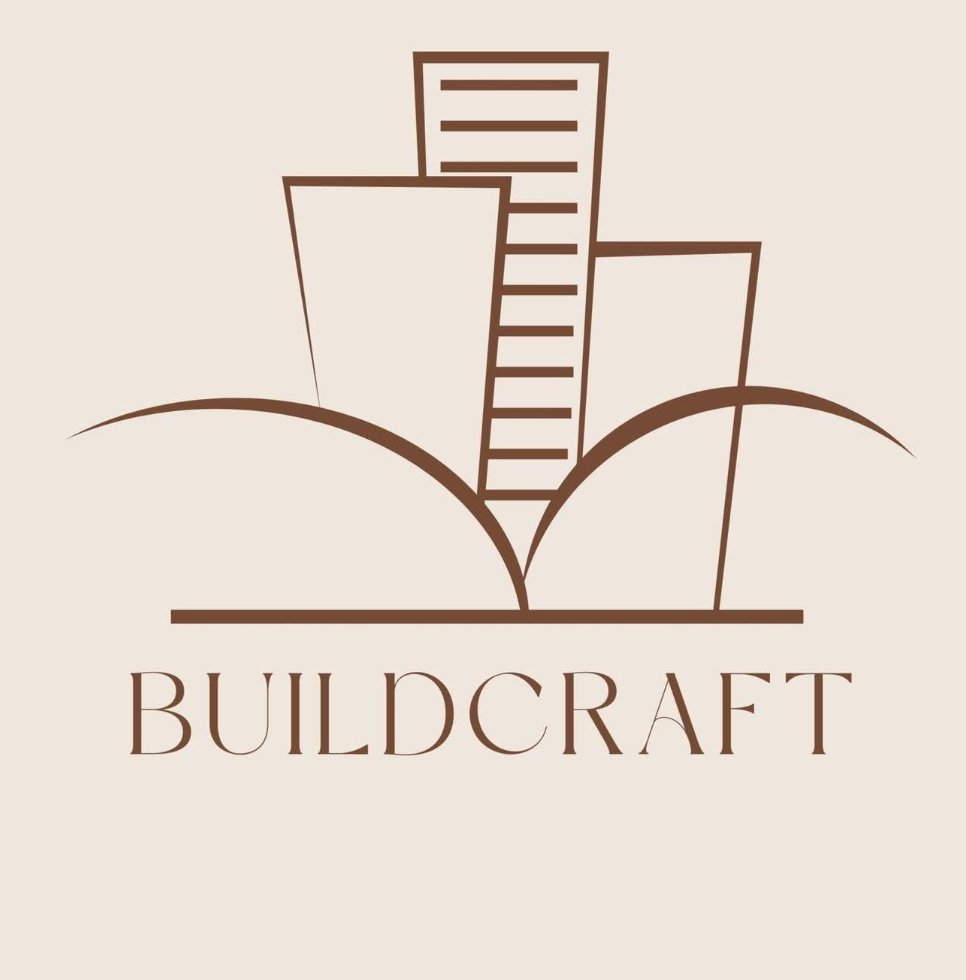

# BUILDCRAFT — Architecture & Interior Design Studio

<p align="center">
  
</p>

<p align="center">
  <strong>Crafting Spaces. Shaping Tomorrow.</strong><br>
  Minimalist Architectural Exterior & Bespoke Interior Design Services
</p>

<p align="center">
  <a href="https://wa.me/8801540053889">
    
  </a>
  <a href="tel:+8801540053889">
    
  </a>
</p>

---

## 🏛️ About BuildCraft

BuildCraft is an architectural visualization and interior design practice based in Dhaka, Bangladesh. We bridge visionary design with structural reality through meticulous exterior architecture, luxury interior space planning, and photorealistic 3D visualization.

### Key Capabilities
- **Exterior Architecture & Facade Design**: Conceptualization, modern elevation, cantilevers, day/night lighting, and landscaping.
- **Interior Architecture & Space Styling**: Bespoke residential master suites, living & dining salons, modular kitchens, and corporate executive offices.
- **3D CGI Visualization**: High-resolution photorealistic renderings and architectural presentations.

---

## ✨ Website Features

- **3D Architectural Hero Canvas**: Interactive 3D parametric pavilion built with **Three.js** featuring mouse-tracking parallax, 360° orbit rotation, and live blueprint wireframe toggle.
- **Smart Category Switcher**: Instantly toggle between **Exterior Design** (9 projects, 67 renders) and **Interior Design** (12 projects, 354 renders).
- **Interactive Lightbox & Filmstrip**: Fullscreen viewer with thumbnail strip, zoom, swipe, and arrow key navigation.
- **Direct WhatsApp & Phone Integration**: Instant consultation link on every project card and quote form routing to WhatsApp (`+880 1540-053889`).
- **Responsive & Lightweight**: Mobile-optimized dark luxury aesthetic.

---

## 🚀 How to Run Locally

### Option 1: Direct Double Click
Simply double-click `open-website.bat` or open `index.html` in any modern web browser.

### Option 2: Local HTTP Server
Run the built-in lightweight Node server:
```bash
node server.js
```
Then visit [http://localhost:3000](http://localhost:3000) in your browser.

---

## 📁 Repository Structure

```
BuildCraft/
├── index.html                 # Main website markup
├── server.js                  # Lightweight zero-dependency HTTP server
├── open-website.bat           # Quick launcher for Windows
├── launch-server.bat          # Server launcher for Windows
├── assets/
│   └── logo.jpg               # Official BuildCraft brand logo
├── css/
│   └── styles.css             # Architectural dark minimalist stylesheet
├── js/
│   ├── three-hero.js          # Three.js 3D architectural canvas engine
│   └── app.js                 # Portfolio tabs, filters, modal lightbox & WhatsApp logic
├── data/
│   ├── projects.js            # Structured JS portfolio dataset
│   └── projects.json          # Portfolio JSON dataset (421 renders cataloged)
├── scripts/
│   └── build-data.js          # Data catalog builder
├── Exterior/                  # 9 Exterior project folders (67 high-res renders)
└── Interior/                  # 12 Interior project folders (354 high-res renders)
```

---

## 📞 Studio Contact

- **Phone / WhatsApp**: [+880 1540-053889](https://wa.me/8801540053889)
- **Location**: Dhaka, Bangladesh
- **Copyright**: © 2026 BuildCraft Architecture Studio. All visual assets and renders reserved.
